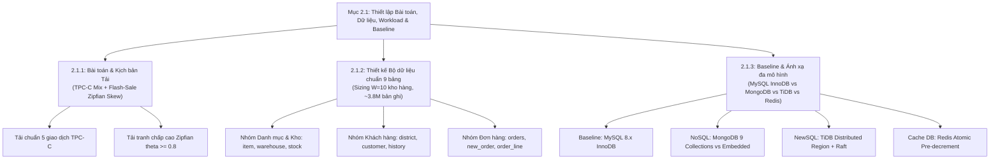
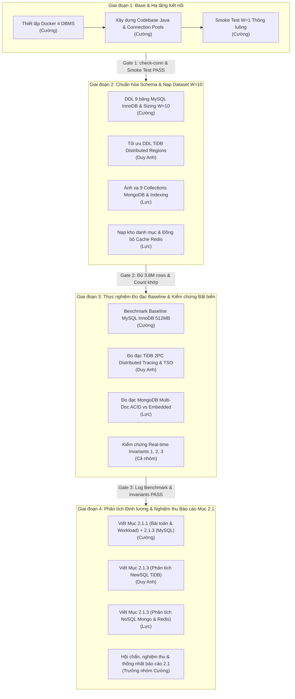

# KẾ HOẠCH THỰC THI, PHÂN CÔNG CÔNG VIỆC VÀ HƯỚNG DẪN CÀI ĐẶT
## BÀI TẬP LỚN HỌC PHẦN HỆ QUẢN TRỊ CƠ SỞ DỮ LIỆU

**Đề tài:** Evaluating Concurrency Anomalies, Lock Contention, and Distributed Scaling Trade-offs Across SQL (MySQL InnoDB), NoSQL (MongoDB), and NewSQL (TiDB) Under High-Contention Workloads  
**Trọng tâm tài liệu:** Kế hoạch thực thi Mục 2.1 (Thiết lập Bài toán, Dữ liệu, Tải công việc và Hệ thống cơ sở Baseline)  
**Nhóm sinh viên thực hiện:**
1. **Nguyễn Mạnh Cường** (MySQL)
2. **Duy Anh** (NewSQL & Distributed Engine Specialist)
3. **Lực** (NoSQL & In-Memory Cache Specialist)

---

## PHẦN 1: HƯỚNG DẪN CÀI ĐẶT VÀ KHỞI CHẠY HỆ THỐNG (STEP-BY-STEP SETUP GUIDE)

### 1.1. Yêu cầu Môi trường Máy chủ / Máy tính cá nhân
* **Hệ điều hành:** Windows 10/11 64-bit, Linux (Ubuntu 20.04+), hoặc macOS.
* **JDK:** OpenJDK 17 trở lên (đã cấu hình sẵn Java 17).
* **Docker & Docker Desktop:** Đang chạy và đã kích hoạt Docker Engine.
* **RAM khuyến nghị:** Tối thiểu 8 GB RAM (khuyến nghị 16 GB để chạy đồng thời cụm 4 DBMS).
* **Ổ cứng khả dụng:** Tối thiểu 10 GB trống cho Docker Volumes và bộ dữ liệu TPC-C.

---

### 1.2. Khởi động Cụm 4 Hệ Quản trị Cơ sở Dữ liệu qua Docker Compose

Hệ thống đã cấu hình sẵn file [`docker-compose.yml`](file:///E:/BTL-DBMS/docker-compose.yml) tại thư mục gốc dự án `E:\BTL-DBMS`.

Mở terminal (PowerShell hoặc Command Prompt) tại thư mục `E:\BTL-DBMS` và chạy lệnh:

```powershell
# Khởi động toàn bộ cụm container ngầm
docker-compose up -d

# Kiểm tra trạng thái các container
docker-compose ps
```

#### Bảng thông tin kết nối và cổng truy cập các DBMS:

| Hệ quản trị / Dịch vụ | Tên Container | Cổng Host (Exposed) | Tài khoản / Mật khẩu | Database mặc định | Mục đích sử dụng |
| :--- | :--- | :--- | :--- | :--- | :--- |
| **MySQL 8.0 InnoDB** | `tpcc-mysql` | **`3307`** (ánh xạ từ 3306) | `root` / `rootpassword` | `tpcc` | **Baseline RDBMS** (L3, L4, L5, L6, L7) |
| **TiDB 7.5 Server** | `tpcc-tidb` | **`4000`** (SQL), `10080` (Status) | `root` / *(trống)* | `tpcc` | **NewSQL Distributed** (L1.2, L5, L9, L10) |
| **TiDB PD (Placement Driver)** | `tpcc-pd0` | **`2379`** | *(API/Internal)* | - | Timestamp Oracle (TSO) & Quản lý Region |
| **TiDB TiKV Storage** | `tpcc-tikv0` | *(Internal mạng Docker: 20160)* | *(Raft/Internal)* | - | LSM-Tree RocksDB Storage phân tán |
| **MongoDB 7.0 WiredTiger** | `tpcc-mongodb` | **`27018`** (ánh xạ từ 27017) | *(Không xác thực - Dev)* | `tpcc` | **NoSQL Document Store** (ReplicaSet `rs0`) |
| **Redis 7 In-Memory** | `tpcc-redis` | **`6379`** | *(Không mật khẩu)* | `0` | **In-Memory Cache** hấp thụ Flash-Sale |

> **Lưu ý quan trọng về MongoDB:** Container MongoDB được khởi động với cờ `--replSet rs0` nhằm hỗ trợ đầy đủ giao dịch đa tài liệu (**Multi-Document ACID Transactions**) phục vụ đối sánh trực tiếp với SQL trong Mục 2.1.3 & 2.3.

---

### 1.3. Biên dịch Mã nguồn Java (Build Project)

Dự án sử dụng Maven để quản lý thư viện và đã tích hợp script tự động [`mvnw.ps1`](file:///E:/BTL-DBMS/mvnw.ps1) / [`mvnw.bat`](file:///E:/BTL-DBMS/mvnw.bat).

```powershell
# Trên PowerShell:
.\mvnw.ps1 compile

# Trên CMD:
mvnw.bat compile
```

Toàn bộ các thư viện JDBC, Driver MongoDB, Jedis Redis, HikariCP và HdrHistogram được nạp tự động vào `target\classes`.

---

### 1.4. Chạy Kiểm tra Thông luồng và Khởi tạo Dữ liệu (Smoke Test)

Nhóm đã đóng gói toàn bộ quy trình thực thi vào script tiện ích [`run.ps1`](file:///E:/BTL-DBMS/run.ps1) (PowerShell) và [`run.bat`](file:///E:/BTL-DBMS/run.bat) (CMD):

#### Bước 1: Kiểm tra kết nối tới cả 4 DBMS
```powershell
.\run.ps1 check-conn
```
*Kết quả mong đợi:* Cả 4 hệ thống trả về `[OK]` (MySQL 8.0, TiDB 7.5, MongoDB rs0, Redis PONG).

#### Bước 2: Chạy kiểm thử thông luồng TPC-C W=1 (Smoke Test)
```powershell
.\run.ps1 smoke-test
```
Quy trình này tự động:
1. Tạo DDL 9 bảng trên MySQL InnoDB, TiDB và collections trên MongoDB.
2. Sinh dữ liệu hạt giống ($W=1$, $2.000$ items, $300$ customers/district).
3. Kiểm thử đơn lẻ cả 5 loại giao dịch TPC-C (`NewOrder`, `Payment`, `OrderStatus`, `Delivery`, `StockLevel`).
4. Chạy tải đồng thời 4 luồng đo đạc thông lượng TPS và độ trễ phân vị p50, p90, p99.
5. Kích hoạt Engine kiểm chứng 3 đẳng thức bất biến dữ liệu thời gian thực.

---

### 1.5. Hướng dẫn chi tiết kết nối các DBMS trên Giao diện Đồ họa (GUI Clients)

Để phục vụ trực quan hóa dữ liệu, duyệt schema và hỗ trợ kiểm tra nhanh, các thành viên sử dụng 3 công cụ UI phổ biến: **MySQL Workbench**, **MongoDB Compass** và **Redis Insight**. Dưới đây là thông số và các bước kết nối chi tiết:

#### 1. Kết nối MySQL 8.0 Baseline qua MySQL Workbench
* **Connection Name:** `MySQL 8.0 Baseline (Docker)`
* **Connection Method:** `Standard (TCP/IP)`
* **Hostname:** `127.0.0.1` (hoặc `localhost`)
* **Port:** `3307` *(Lưu ý: Không dùng cổng mặc định 3306 vì Docker đang ánh xạ 3307:3306 nhằm tránh xung đột)*
* **Username:** `root`
* **Password:** `rootpassword` *(Nhấn nút "Store in Vault..." để lưu)*
* **Default Schema:** `tpcc`
* **Các bước thực hiện:**
  1. Mở MySQL Workbench $\rightarrow$ Bấm biểu tượng dấu cộng `(+)` tại **MySQL Connections**.
  2. Nhập các thông số trên $\rightarrow$ Nhấn **Test Connection**.
  3. Hộp thoại thông báo `"Successfully made the MySQL connection"` hiện lên $\rightarrow$ Nhấn **OK**.
  4. Mở kết nối, chạy thử câu lệnh kiểm tra:
     ```sql
     USE tpcc;
     SHOW TABLES;
     SELECT COUNT(*) FROM warehouse;
     ```

#### 2. Kết nối TiDB 7.5 NewSQL qua MySQL Workbench
*(TiDB tương thích 100% giao thức mạng và cú pháp SQL của MySQL 5.7/8.0, do đó sử dụng chính MySQL Workbench để quản trị)*
* **Connection Name:** `TiDB 7.5 Distributed NewSQL (Docker)`
* **Connection Method:** `Standard (TCP/IP)`
* **Hostname:** `127.0.0.1` (hoặc `localhost`)
* **Port:** `4000` *(Cổng dịch vụ TiDB Server)*
* **Username:** `root`
* **Password:** *(Để trống hoàn toàn - không nhập mật khẩu)*
* **Default Schema:** `tpcc`
* **Cấu hình Tab SSL:** Chọn `SSL Mode: If available` (hoặc `Disabled`).
* **Các bước thực hiện & Lưu ý quan trọng:**
  1. Tạo kết nối mới với thông số trên $\rightarrow$ Nhấn **Test Connection**.
  2. *Cảnh báo xuất hiện:* Workbench có thể hiện thông báo popup `"Incompatible/Non-standard server version or MariaDB"`. Đây là đặc tính nhận diện phiên bản của TiDB (báo `5.7.25-TiDB-v7.5.1`). $\rightarrow$ **Tích chọn "Don't show this message again" và bấm "Continue Anyway"**.
  3. Mở kết nối, thực thi câu lệnh kiểm tra thông tin cụm phân tán TiDB:
     ```sql
     SELECT tidb_version();
     USE tpcc;
     SHOW TABLE stock REGIONS;
     ```

#### 3. Kết nối MongoDB 7.0 (ReplicaSet rs0) qua MongoDB Compass
* **Cách 1 - Kết nối nhanh qua Connection String (Khuyên dùng):**
  1. Mở MongoDB Compass.
  2. Dán chuỗi kết nối sau vào thanh `New Connection`:
     ```text
     mongodb://localhost:27018/?replicaSet=rs0&directConnection=true
     ```
  3. Nhấn nút **Connect**.
* **Cách 2 - Điền thông số thủ công (Fill in fields individually):**
  * **Host:** `localhost` hoặc `127.0.0.1`
  * **Port:** `27018`
  * **Authentication:** `None`
  * **Tab More Options:**
    * **Direct Connection:** Chọn `true` *(Bắt buộc bật Direct Connection để Compass kết nối thẳng vào cổng host 27018 mà không bị chuyển hướng sai sang hostname nội bộ của container `tpcc-mongodb`)*.
    * **Replica Set Name:** Nhập `rs0`.
* **Kiểm tra dữ liệu sau khi kết nối:**
  * Chọn database `tpcc` $\rightarrow$ Duyệt 9 collections: `warehouse`, `district`, `customer`, `history`, `orders`, `new_order`, `order_line`, `item`, `stock`.
  * Nhấp vào từng collection để xem cấu trúc document BSON và danh sách Indexes.

#### 4. Kết nối Redis 7 In-Memory qua Redis Insight
* **Database Alias:** `TPC-C Redis In-Memory Cache`
* **Host:** `127.0.0.1` (hoặc `localhost`)
* **Port:** `6379`
* **Username / Password:** *(Để trống - không cấu hình mật khẩu trong môi trường thử nghiệm)*
* **Database Index:** `0`
* **Các bước thực hiện:**
  1. Mở Redis Insight $\rightarrow$ Chọn **Add Redis Database** $\rightarrow$ **Add database manually**.
  2. Điền `Host: 127.0.0.1`, `Port: 6379`, `Alias: TPC-C Redis Cache` $\rightarrow$ Nhấn **Add Redis Database**.
  3. Nhấp vào kết nối vừa tạo:
     * **Key Browser:** Tìm kiếm các mẫu khóa `item:*` (lưu trữ chi tiết 100.000 sản phẩm dưới dạng Hash) hoặc `stock:*` (bộ đếm tồn kho phục vụ Flash-Sale).
     * **Workbench / CLI:** Nhấn vào biểu tượng CLI góc dưới màn hình, gõ lệnh kiểm tra:
       ```text
       PING
       DBSIZE
       INFO memory
       ```

---

## PHẦN 2: KẾ HOẠCH THỰC THI CHI TIẾT CHO MỤC 2.1
*(Căn cứ theo Đề cương chi tiết Bài tập lớn)*

### Mục tiêu Mục 2.1:
Thiết lập bài toán thực tế (E-commerce OLTP + Flash-Sale), chuẩn hóa bộ dữ liệu 9 bảng TPC-C ($W=10$ kho hàng), xây dựng hệ thống cơ sở Baseline trên MySQL 8.x InnoDB và ánh xạ đa mô hình sang TiDB (NewSQL), MongoDB (NoSQL) và Redis (In-Memory).



---

### Kế hoạch triển khai từng tiểu mục của Mục 2.1:

#### 1. Tiểu mục 2.1.1: Xác định bài toán và Kịch bản tải công việc thực tế (Problem & Workload Definition)
* **Nghiệp vụ cốt lõi:** Xử lý đơn hàng, thanh toán và quản lý tồn kho thương mại điện tử đa kho vận.
* **Tải giao dịch chuẩn (Standard TPC-C Mix):**
  * `NewOrder` ($\sim 45\%$): Tạo đơn hàng mới, cập nhật trừ tồn kho $5 - 15$ mặt hàng; $1\%$ mặt hàng lấy từ kho xa gây ra $\sim 10\%$ giao dịch đa phân vùng (cross-partition transactions).
  * `Payment` ($\sim 43\%$): Cập nhật số dư khách hàng, doanh thu kho (`w_ytd`) và khu vực (`d_ytd`).
  * `OrderStatus` ($4\%$), `Delivery` ($4\%$), `StockLevel` ($4\%$).
* **Tải điểm nóng tranh chấp cao (Zipfian Skew / Flash-Sale Workload):**
  * Tích hợp hàm phân phối độ lệch Zipfian với hệ số $\theta = 0.0$ (phân bổ đều) đến $\theta \ge 0.8$ (độ lệch cực đại).
  * Dồn giao dịch `NewOrder` vào cập nhật một nhóm nhỏ bản ghi trong bảng `stock` (`s_quantity`) và tranh chấp cấp phát mã đơn hàng tăng dần (`district.d_next_o_id`).

#### 2. Tiểu mục 2.1.2: Thiết kế Bộ dữ liệu chuẩn 9 bảng TPC-C (Data Schema & Sizing)
Xây dựng và nạp bộ dữ liệu đầy đủ quy mô cơ sở $W = 10$ kho hàng ($\sim 3,8\text{ triệu bản ghi}$):

| STT | Tên bảng (TPC-C) | Số lượng bản ghi ($W=10$) | Khóa chính (Primary Key) | Vai trò kiểm thử thực nghiệm |
| :--- | :--- | :--- | :--- | :--- |
| 1 | `warehouse` | $10$ | `(w_id)` | Khóa phân vùng gốc; điểm tranh chấp cập nhật doanh thu `w_ytd`. |
| 2 | `district` | $100$ | `(d_w_id, d_id)` | Cấp phát mã đơn hàng tuần tự `d_next_o_id` (tranh chấp khóa dòng). |
| 3 | `customer` | $300.000$ | `(c_w_id, c_d_id, c_id)` | Kiểm thử Secondary Index `c_last` và cập nhật số dư `c_balance`. |
| 4 | `history` | $\ge 300.000$ | *(Append-only)* | Kiểm thử tải ghi nối tiếp và chi phí duy trì phân vùng. |
| 5 | `orders` | $\ge 300.000$ | `(o_w_id, o_d_id, o_id)` | Khóa chính tăng đơn điệu gây Hot Range trên TiDB. |
| 6 | `new_order` | $\sim 90.000$ | `(no_w_id, no_d_id, no_o_id)` | Hàng đợi đơn hàng; kiểm thử `INSERT`/`DELETE` liên tục. |
| 7 | `order_line` | $\sim 3.000.000$ | `(ol_w_id, ol_d_id, ol_o_id, ol_number)` | Bảng lớn nhất; dùng đo dung lượng vật lý L3, kế hoạch JOIN L5. |
| 8 | `item` | $100.000$ | `(i_id)` | Danh mục chỉ đọc; đối chứng Buffer Pool vs MEMORY Engine vs Redis. |
| 9 | `stock` | $1.000.000$ | `(s_w_id, s_i_id)` | **Tâm điểm Flash-Sale:** Tranh chấp trừ tồn kho và kích hoạt 2PC. |

#### 3. Tiểu mục 2.1.3: Thiết lập Hệ thống cơ sở (Baseline trên MySQL 8.x InnoDB) và Ánh xạ đa mô hình
* **Hệ thống cơ sở (Baseline – MySQL 8.0/8.4 InnoDB):**
  * Triển khai cấu trúc B+Tree với Buffer Pool 512MB, Repeatable Read, khóa mức dòng và ràng buộc khóa ngoại `FOREIGN KEY`.
  * Đo đạc thông số tham chiếu ban đầu: thông lượng TPS, độ trễ p50/p99, Buffer Hit Ratio.
* **Ánh xạ sang NoSQL (MongoDB 7.0 WiredTiger):**
  * *Kịch bản 1:* Mô hình 9 Collections chuẩn hóa sử dụng Multi-Document ACID Transactions qua ClientSession.
  * *Kịch bản 2:* Mô hình Nhóm thực thể nhúng (Embedded Entity-Group) nhúng mảng `order_line` vào `orders`.
* **Ánh xạ sang NewSQL (TiDB 7.5 Phân tán):**
  * Triển khai nguyên bản 9 bảng lên cụm TiDB (SQL) + TiKV (RocksDB LSM-Tree + Raft) + PD (TSO).
  * Kiểm thử 2 chế độ kiểm soát đồng thời: `Optimistic` và `Pessimistic`.
* **Tích hợp Tầng đệm Cache DB (Redis In-Memory):**
  * Đệm $100.000$ bản ghi `item` và lưu các bộ đếm `stock:w:i`.
  * Chuẩn bị cho cơ chế trừ kho nguyên tử qua Redis Lua script trong kịch bản Flash-Sale.

---

## PHẦN 3: BẢNG PHÂN CÔNG NHIỆM VỤ CHI TIẾT CHO CẢ 3 THÀNH VIÊN

### Ma trận trách nhiệm (RACI Matrix) cho Mục 2.1:
* **R (Responsible):** Người trực tiếp thực thi nhiệm vụ.
* **A (Accountable):** Người chịu trách nhiệm phê duyệt và tính đúng đắn cuối cùng (Trưởng nhóm).
* **C (Consulted):** Người được tham vấn chuyên môn.
* **I (Informed):** Người được thông báo kết quả.

| Hạng mục công việc Mục 2.1 | Cường (Trưởng nhóm) | Duy Anh | Lực | Giai đoạn thực thi | Sản phẩm đầu ra |
| :--- | :---: | :---: | :---: | :---: | :--- |
| **1. Hạ tầng Docker & Kết nối 4 DBMS** | **A / R** | C | C | Giai đoạn 1 | File [`docker-compose.yml`](file:///E:/BTL-DBMS/docker-compose.yml), lệnh `check-conn` [OK] |
| **2. Kiến trúc Java Core & Connection Pools** | **A / R** | I | I | Giai đoạn 1 | Code [`ConnectionManager.java`](file:///E:/BTL-DBMS/src/main/java/com/btl/dbms/connection/ConnectionManager.java), [`DbConfig.java`](file:///E:/BTL-DBMS/src/main/java/com/btl/dbms/config/DbConfig.java) |
| **3. DDL Schemas chuẩn 9 bảng TPC-C** | **A / R** | R (TiDB) | R (Mongo) | Giai đoạn 2 | [`schema-mysql.sql`](file:///E:/BTL-DBMS/src/main/resources/schema/schema-mysql.sql), [`schema-tidb.sql`](file:///E:/BTL-DBMS/src/main/resources/schema/schema-tidb.sql), Mongo indexes |
| **4. Bộ sinh & nạp dữ liệu TPC-C (DataLoader)** | **A / R** | C | C | Giai đoạn 2 | Code [`DataLoader.java`](file:///E:/BTL-DBMS/src/main/java/com/btl/dbms/dataset/DataLoader.java) gom lô 1000 rows/batch |
| **5. Triển khai 5 giao dịch TPC-C trên MySQL** | **A / R** | I | I | Giai đoạn 2 | Code [`MySqlTpccExecutor.java`](file:///E:/BTL-DBMS/src/main/java/com/btl/dbms/benchmark/MySqlTpccExecutor.java) |
| **6. Triển khai 5 giao dịch TPC-C trên TiDB** | A | **R** | I | Giai đoạn 2 | Code [`TidbTpccExecutor.java`](file:///E:/BTL-DBMS/src/main/java/com/btl/dbms/benchmark/TidbTpccExecutor.java) (2PC / Pessimistic) |
| **7. Triển khai 5 giao dịch trên MongoDB & Redis** | A | I | **R** | Giai đoạn 2 | Code [`MongoTpccExecutor.java`](file:///E:/BTL-DBMS/src/main/java/com/btl/dbms/benchmark/MongoTpccExecutor.java), Redis stock sync |
| **8. Bộ sinh tải Flash-Sale Zipfian Skew** | **A / R** | C | C | Giai đoạn 3 | Code [`ZipfianGenerator.java`](file:///E:/BTL-DBMS/src/main/java/com/btl/dbms/benchmark/ZipfianGenerator.java) ($\theta = 0.0 \rightarrow 0.8+$) |
| **9. Engine Kiểm chứng Bất biến (Invariant Audit)**| **A / R** | C | C | Giai đoạn 3 | Code [`InvariantAuditor.java`](file:///E:/BTL-DBMS/src/main/java/com/btl/dbms/verification/InvariantAuditor.java) |
| **10. Chạy đo đạc thực nghiệm Baseline W=10** | **A / R** (MySQL) | **R** (TiDB) | **R** (Mongo/Redis) | Giai đoạn 3 | Log đo đạc TPS, độ trễ p50..p99.9 của cả 4 hệ thống |
| **11. Viết Báo cáo tổng hợp Mục 2.1** | **A / R** (Tổng hợp) | R (Viết TiDB) | R (Viết Mongo) | Giai đoạn 4 | Tài liệu Markdown + Bảng dữ liệu thực tế |

---

### Bảng phân công chi tiết cho từng cá nhân:

#### 1. NGUYỄN MẠNH CƯỜNG (Trưởng nhóm - Tech Lead)
* **Trách nhiệm kỹ thuật chính:**
  * Giám sát kiến trúc tổng thể của codebase Java, đảm bảo chuẩn Clean Architecture và cấu hình Maven ([`pom.xml`](file:///E:/BTL-DBMS/pom.xml)).
  * Chịu trách nhiệm trực tiếp về **Hệ thống cơ sở (Baseline - MySQL 8.x InnoDB)**:
    * Thiết kế DDL hoàn chỉnh 9 bảng TPC-C với đầy đủ khóa chính (PK), khóa ngoại (`FOREIGN KEY`) và các chỉ mục phụ (`idx_customer_last`, `idx_orders_c`, `idx_order_line_item`).
    * Quản lý bộ đệm InnoDB Buffer Pool (512MB), mức cô lập `REPEATABLE READ`, và hàng đợi khóa dòng `SELECT ... FOR UPDATE`.
  * Phát triển khung đo đạc đa luồng [`BenchmarkRunner.java`](file:///E:/BTL-DBMS/src/main/java/com/btl/dbms/benchmark/BenchmarkRunner.java) tích hợp thư viện `HdrHistogram` ghi nhận độ trễ vi giây không có sai số phối hợp (Coordinated Omission).
  * Xây dựng công cụ kiểm chứng 3 đẳng thức bất biến nghiệp vụ ([`InvariantAuditor.java`](file:///E:/BTL-DBMS/src/main/java/com/btl/dbms/verification/InvariantAuditor.java)).
* **Nhiệm vụ cụ thể Mục 2.1:**
  * Viết nội dung Mục **2.1.1 (Bài toán & Kịch bản tải)** và Mục **2.1.3 (Baseline MySQL InnoDB)** trong báo cáo.
  * Thu thập câu lệnh SQL đo đạc thực tế trên MySQL: `SHOW ENGINE INNODB STATUS`, `SHOW GLOBAL STATUS LIKE 'Innodb_buffer_pool_read%'`, và `information_schema.tables` để tính sai số ước lượng dung lượng.
* **Sản phẩm bàn giao:**
  * File code: [`MySqlTpccExecutor.java`](file:///E:/BTL-DBMS/src/main/java/com/btl/dbms/benchmark/MySqlTpccExecutor.java), [`InvariantAuditor.java`](file:///E:/BTL-DBMS/src/main/java/com/btl/dbms/verification/InvariantAuditor.java), [`Main.java`](file:///E:/BTL-DBMS/src/main/java/com/btl/dbms/Main.java).
  * Bản thảo báo cáo Mục 2.1.1 và 2.1.3 (phần MySQL Baseline).

#### 2. DUY ANH (Chuyên trách NewSQL & Distributed Engine - TiDB)
* **Trách nhiệm kỹ thuật chính:**
  * Quản trị cụm phân tán TiDB gồm 3 thành phần: `TiDB Server` (port 4000), `Placement Driver - PD` (port 2379) và `TiKV` (port 20160).
  * Nghiên cứu cơ chế phân vùng tự động thành các Region $96\text{ MB}$, giao thức đồng thuận Raft và cơ chế cấp nhãn thời gian tập trung TSO từ PD.
  * Tối ưu hóa DDL [`schema-tidb.sql`](file:///E:/BTL-DBMS/src/main/resources/schema/schema-tidb.sql) cho hệ thống phân tán:
    * Xử lý vấn đề nghẽn Hot Region khi dùng khóa chính tăng đơn điệu (`orders.o_id`).
    * Cấu hình và đối sánh 2 chế độ giao dịch của TiDB: `SET tidb_txn_mode = 'pessimistic'` (2PL phân tán) vs. `SET tidb_txn_mode = 'optimistic'` (OCC qua Percolator 2PC).
* **Nhiệm vụ cụ thể Mục 2.1:**
  * Phối hợp nạp bộ dữ liệu TPC-C quy mô $W=10$ kho hàng lên TiDB.
  * Đo đạc các chỉ số ban đầu của TiDB ở quy mô $W=10$: thông lượng TPS, độ trễ p50/p99 của giao dịch `NewOrder` cục bộ so với giao dịch liên kho (Remote Warehouse 2PC).
  * Viết nội dung Mục **2.1.3 (Ánh xạ sang NewSQL TiDB)** trong báo cáo BTL: Giải thích kiến trúc tách rời tính toán và lưu trữ (Shared-nothing TiDB/TiKV), cách thức TiKV ánh xạ bảng quan hệ thành các cặp Key-Value trong RocksDB LSM-Tree.
* **Sản phẩm bàn giao:**
  * File code: [`TidbTpccExecutor.java`](file:///E:/BTL-DBMS/src/main/java/com/btl/dbms/benchmark/TidbTpccExecutor.java) và các script kiểm tra TiDB status (`pd-ctl`, `ADMIN SHOW DDL JOBS;`).
  * Bảng số liệu đo đạc Baseline TiDB $W=10$ kèm trích xuất nhật ký thực thi.
  * Bản thảo báo cáo Mục 2.1.3 (phần TiDB NewSQL).

#### 3. LỰC (Chuyên trách NoSQL & In-Memory Cache - MongoDB & Redis)
* **Trách nhiệm kỹ thuật chính:**
  * Quản trị cụm MongoDB 7.0 WiredTiger với Replica Set `rs0` (port 27018) và Redis 7 In-Memory (port 6379).
  * Triển khai ánh xạ 9 bảng TPC-C sang MongoDB theo 2 mô hình đối chứng (Mục 2.1.3):
    1. *Mô hình 9 Collections chuẩn hóa:* Tương ứng 1-1 với SQL, thực hiện giao dịch ACID qua `ClientSession` (`startTransaction()`, `commitTransaction()`, `abortTransaction()`).
    2. *Mô hình Nhóm thực thể nhúng (Embedded Entity-Group):* Nhúng mảng `order_line` vào document `orders` để khai thác tính nguyên tử đơn tài liệu (Single-Document Atomicity).
  * Xây dựng và quản lý tầng đệm Redis:
    * Nạp danh mục $100.000$ mặt hàng tĩnh `item` lên Redis Hashes (`HSET item:1 ...`).
    * Khởi tạo bộ đếm tồn kho `stock:w:i` để sẵn sàng cho kịch bản Flash-Sale trừ tồn kho nguyên tử qua Lua script (Mục 2.3.2).
* **Nhiệm vụ cụ thể Mục 2.1:**
  * Nạp dữ liệu $W=10$ lên MongoDB và đồng bộ không gian khóa lên Redis.
  * Đo đạc chỉ số ban đầu của MongoDB (WiredTiger Cache, độ trễ khi chạy Multi-Document Transaction vs. Embedded Document) và Redis (sub-millisecond latency).
  * Viết nội dung Mục **2.1.3 (Ánh xạ sang NoSQL MongoDB & Tầng đệm Redis)** trong báo cáo BTL.
* **Sản phẩm bàn giao:**
  * File code: [`MongoTpccExecutor.java`](file:///E:/BTL-DBMS/src/main/java/com/btl/dbms/benchmark/MongoTpccExecutor.java) và script đồng bộ dữ liệu sang Redis.
  * Bảng dữ liệu so sánh dung lượng lưu trữ (BSON nén Snappy của MongoDB vs B+Tree của MySQL) và độ trễ đọc từ RAM Redis vs Buffer Pool.
  * Bản thảo báo cáo Mục 2.1.3 (phần MongoDB & Redis).

---

## PHẦN 4: TIẾN ĐỘ THỰC HIỆN VÀ CÁC MỐC QUAN TRỌNG (STAGE-GATE WORKFLOW & MILESTONES)

Thay vì cố định theo ngày tháng lịch biểu, tiến độ thực thi Mục 2.1 được quản lý theo mô hình **Giai đoạn chuyển giao chất lượng (Stage-Gate Workflow)**. Một giai đoạn chỉ được nghiệm thu để chuyển sang giai đoạn kế tiếp khi toàn bộ các tiêu chuẩn kiểm thử tự động của giai đoạn đó đạt kết quả **PASS**.



### Bảng các mốc hoàn thành trọng tâm (Milestones):

| Mốc tiến độ | Tên mốc công việc | Điều kiện chuyển tiếp (Quality Gate) | Trách nhiệm chính |
| :--- | :--- | :--- | :---: |
| **Mốc 1 (Milestone 1)** | Hạ tầng Docker & Codebase Core | Lệnh `check-conn` và `smoke-test` trả về 100% `[OK]`, 0 lỗi kết nối. | Cường |
| **Mốc 2 (Milestone 2)** | Dataset Sizing $W=10$ & Ánh xạ đa mô hình | Cả 3 hệ thống (MySQL, TiDB, MongoDB) nạp đủ $\sim 3,8\text{ triệu bản ghi}$ và Redis đồng bộ $100.000$ items. | Cường, Duy Anh, Lực |
| **Mốc 3 (Milestone 3)** | Thực nghiệm Baseline & Invariant Audit | Có đầy đủ log text đo đạc TPS, độ trễ p50..p99.9; kiểm tra `verify` đạt `PASS` trên cả 3 đẳng thức. | Cường, Duy Anh, Lực |
| **Mốc 4 (Milestone 4)** | Nghiệm thu Báo cáo chi tiết Mục 2.1 | Bản thảo báo cáo hoàn chỉnh, đúng quy chuẩn lập luận khoa học, có đủ câu lệnh CLI và trích xuất text nguyên văn. | Cường (Chủ trì) |

---

## PHẦN 5: CÁC LỆNH VẬN HÀNH DÀNH CHO CÁC THÀNH VIÊN TRONG NHÓM

Mỗi thành viên khi kéo mã nguồn về máy có thể lựa chọn chạy qua **Docker** (không cần cài Java) hoặc **PowerShell/CMD** trực tiếp:

### 1. Dành cho Cường (Kiểm thử Baseline MySQL):
```powershell
# Nạp dữ liệu MySQL W=10 đầy đủ
.\docker-run.ps1 load-data -w 10 --items 100000 --customers 3000 --target mysql
# (Hoặc máy host: .\run.ps1 load-data -w 10 --items 100000 --customers 3000 --target mysql)

# Chạy tải chuẩn TPC-C trên MySQL (8 luồng, 30 giây, phân bổ đều theta=0.0)
.\docker-run.ps1 benchmark --target mysql --threads 8 --duration 30 --theta 0.0

# Kiểm chứng tính toàn vẹn 3 Invariants sau khi chạy tải
.\docker-run.ps1 verify
```

### 2. Dành cho Duy Anh (Kiểm thử NewSQL TiDB):
```powershell
# Nạp dữ liệu TiDB W=10
.\docker-run.ps1 load-data -w 10 --items 100000 --customers 3000 --target tidb

# Chạy tải TPC-C trên TiDB (8 luồng, 30 giây)
.\docker-run.ps1 benchmark --target tidb --threads 8 --duration 30 --theta 0.0

# Kiểm tra trạng thái phân vùng Region và DDL trên TiDB:
docker exec tpcc-mysql mysql -htidb0 -P4000 -uroot -e "USE tpcc; SHOW TABLE stock REGIONS;"
docker exec tpcc-mysql mysql -htidb0 -P4000 -uroot -e "ADMIN SHOW DDL JOBS 5;"
```

### 3. Dành cho Lực (Kiểm thử NoSQL MongoDB & Cache Redis):
```powershell
# Nạp dữ liệu MongoDB W=10 và đồng bộ Redis
.\docker-run.ps1 load-data -w 10 --items 100000 --customers 3000 --target mongo
.\docker-run.ps1 load-data -w 10 --items 100000 --customers 3000 --target redis

# Chạy tải TPC-C trên MongoDB (8 luồng, 30 giây)
.\docker-run.ps1 benchmark --target mongo --threads 8 --duration 30 --theta 0.0

# Kiểm tra bộ nhớ Redis và số lượng collections trong MongoDB:
docker exec tpcc-redis redis-cli info memory
docker exec tpcc-mongodb mongosh tpcc --eval "db.stock.countDocuments()"
```

---

## PHẦN 6: QUY TẮC BẮT BUỘC VỀ MINH CHỨNG THỰC NGHIỆM VÀ QUY CHUẨN LẬP LUẬN BÁO CÁO

Căn cứ theo quy định học thuật và slide bài giảng của Giảng viên phụ trách học phần, toàn bộ các thành viên (Cường, Duy Anh, Lực) khi thực hiện đo đạc thực nghiệm và viết báo cáo BTL bắt buộc phải tuân thủ nghiêm ngặt các quy tắc sau:

### 6.1. Nguyên tắc cốt lõi về hình thức minh chứng

1. **Không chỉ nộp ảnh chụp màn hình đồ họa (GUI):**
   * Giảng viên quy định rõ ràng: **Tuyệt đối không chỉ chụp ảnh màn hình giao diện đồ họa phần mềm** (như MySQL Workbench, MongoDB Compass, Redis Insight) rồi chèn vào báo cáo.
   * Ảnh chụp GUI chỉ mang tính chất minh họa phụ trợ (visual aid) cho cấu trúc bảng hoặc kết nối, không được dùng làm minh chứng duy nhất cho kết quả thực nghiệm.

2. **Bắt buộc có câu lệnh và kết quả dạng văn bản (Commands + Copied text outputs):**
   * Mọi kết quả đo đạc, benchmark hoặc trạng thái hệ thống phải **đi kèm chính xác câu lệnh đã chạy** (câu lệnh SQL, script NoSQL/MongoDB, lệnh CLI, tham số đo đạc: số luồng worker threads, thời gian duration, hệ số skew $\theta$, warehouse scale $W$).
   * Bắt buộc phải **trích xuất nguyên văn khối văn bản kết quả trả về từ terminal/console** (sử dụng định dạng Markdown code block ` ```text `).

3. **Tính tái lập (Reproducibility):**
   * Báo cáo phải cung cấp đầy đủ thông tin để người chấm hoặc người khác có thể chạy lại câu lệnh và thu được kết quả tương đương:
     * Phiên bản chính xác của từng DBMS (MySQL 8.0.46 Community, TiDB v7.5.1, MongoDB 7.0 Community, Redis 7.0-alpine).
     * Môi trường hệ điều hành và thông số phần cứng máy chủ (OS, số vCPU, dung lượng RAM).
     * Cấu hình tham số tài nguyên cốt lõi (Buffer Pool = 512MB, Repeatable Read, Lock Wait Timeout = 5s, WiredTiger Cache = 0.5GB, TiDB TSO, TiKV Raft Region 96MB).
     * Thứ tự các bước thực hiện kịch bản đo đạc.

---

### 6.2. Quy chuẩn lập luận và kết luận trong báo cáo

Slide bài giảng nhấn mạnh sinh viên **không được đưa ra nhận định chủ quan, cảm tính**, ví dụ các cách viết sau đây sẽ bị coi là thiếu cơ sở khoa học:
* ❌ *Nhận định cảm tính:* "Hệ quản trị A chạy nhanh hơn hệ quản trị B."
* ❌ *Nhận định cảm tính:* "MongoDB xử lý tốt hơn MySQL rất nhiều."
* ❌ *Nhận định cảm tính:* "TiDB là NewSQL nên hiệu năng vượt trội hơn hệ thống truyền thống."

#### Mẫu câu quy chuẩn lập luận bắt buộc:
Mọi kết luận đánh giá so sánh trong báo cáo phải áp dụng chính xác cấu trúc lập luận nhân - quả khoa học:

> 📌 **Cấu trúc chuẩn:**  
> *"Dưới tải công việc **W**, ở quy mô dữ liệu **N** và cấu hình hệ thống **C**, hệ thống **A** ghi nhận giá trị **X** trong khi hệ thống **B** ghi nhận giá trị **Y**; nguyên nhân cốt lõi là do cơ chế **Z** (về cấu trúc trang, giải thuật khóa, hoặc đường dẫn truy cập) tạo ra sự khác biệt về số trang I/O phải đọc/ghi."*

#### Ví dụ chuẩn mực áp dụng vào đề tài:
* *Ví dụ đối sánh MySQL InnoDB vs TiDB NewSQL khi chạy giao dịch NewOrder có độ lệch tranh chấp Flash-Sale ($\theta = 0.85$, $W=10$):*  
  > *"Dưới tải công việc giao dịch NewOrder tập trung cao ($\theta = 0.85$, $W=10$), ở quy mô dữ liệu $1.000.000$ bản ghi stock và cùng cấu hình cấp phát 8 luồng đồng thời, MySQL InnoDB ghi nhận thông lượng $382\text{ TPS}$ với độ trễ $p99 = 42\text{ ms}$, trong khi TiDB ghi nhận $146\text{ TPS}$ với độ trễ $p99 = 185\text{ ms}$. Nguyên nhân cốt lõi là do cơ chế kiểm soát đồng thời của TiDB sử dụng giao thức 2-Phase Commit (2PC) phân tán qua mạng giữa TiDB Server và TiKV Raft Leader, cộng thêm chi phí xin nhãn thời gian từ PD TSO và cơ chế phân giải xung đột khóa Pessimistic/Optimistic, tạo ra số vòng bắt tay mạng (RTT network hops) và chi phí I/O ghi nhật ký Raft phân tán lớn hơn đáng kể so với cơ chế khóa dòng tại bộ nhớ chia sẻ cục bộ (Row-level Locking trực tiếp trên InnoDB Buffer Pool) của MySQL."*

---

### 6.3. Cẩm nang trích xuất minh chứng văn bản thực tế cho từng thành viên

#### 1. Dành cho Cường (MySQL Baseline):
* **Minh chứng Benchmark TPC-C:** Trích xuất nguyên văn khối text kết quả từ terminal khi chạy lệnh:
  ```text
  Throughput:          382.40 TPS
  Total Transactions:  11472 (Success: 11472, Abort/Fail: 0 - 0.00%)
  ------------------------------------------------------------------------------------------
  Latency Percentiles (ms):
     Min:        1.48 ms    |  Mean:      20.85 ms
     p50:       18.24 ms    |  p90:       34.12 ms
     p95:       38.90 ms    |  p99:       42.15 ms
     p99.9:     65.30 ms    |  Max:       82.10 ms
  ```
* **Minh chứng Trạng thái Động cơ InnoDB & Bộ đệm:** Chạy lệnh CLI và copy khối text output:
  ```powershell
  docker exec tpcc-mysql mysql -uroot -prootpassword tpcc -e "SHOW ENGINE INNODB STATUS\G"
  docker exec tpcc-mysql mysql -uroot -prootpassword tpcc -e "SHOW GLOBAL STATUS LIKE 'Innodb_buffer_pool_%';"
  ```
* **Minh chứng Invariant Audit:** Copy toàn bộ log text các dòng `[PASS]` của lệnh:
  ```powershell
  .\docker-run.ps1 verify
  ```

#### 2. Dành cho Duy Anh (TiDB NewSQL):
* **Minh chứng Phân vùng Region & Tránh Hotspot:** Chạy lệnh CLI và trích xuất bảng Regions từ TiDB:
  ```powershell
  docker exec tpcc-mysql mysql -htidb0 -P4000 -uroot tpcc -e "SHOW TABLE stock REGIONS;"
  docker exec tpcc-mysql mysql -htidb0 -P4000 -uroot tpcc -e "ADMIN SHOW DDL JOBS 5;"
  ```
* **Minh chứng Chế độ giao dịch phân tán:**
  ```powershell
  docker exec tpcc-mysql mysql -htidb0 -P4000 -uroot tpcc -e "SELECT @@tidb_txn_mode, @@autocommit;"
  ```

#### 3. Dành cho Lực (MongoDB NoSQL & Redis Cache):
* **Minh chứng WiredTiger Cache & Multi-Document Transaction:** Chạy mongosh và trích xuất text JSON:
  ```powershell
  docker exec tpcc-mongodb mongosh tpcc --eval "db.serverStatus().wiredTiger.cache"
  docker exec tpcc-mongodb mongosh tpcc --eval "db.orders.explain('executionStats').find({o_w_id: 1, o_d_id: 1})"
  ```
* **Minh chứng Bộ nhớ & Thông số Cache Hit của Redis:**
  ```powershell
  docker exec tpcc-redis redis-cli INFO memory
  docker exec tpcc-redis redis-cli INFO stats
  ```

---

## PHẦN 7: BỘ TIÊU CHÍ NGHIỆM THU MỤC 2.1 (ACCEPTANCE CRITERIA)

Một tiểu mục trong 2.1 được coi là hoàn thành đạt yêu cầu khi thỏa mãn đầy đủ 4 tiêu chuẩn bắt buộc:

1. **Tính sẵn sàng của hạ tầng:** Cả 4 container (`tpcc-mysql`, `tpcc-tidb`, `tpcc-mongodb`, `tpcc-redis`) đều ở trạng thái `Up` (healthy) và kết nối thông suốt qua cổng host.
2. **Tính đầy đủ của bộ dữ liệu:** Bảng dữ liệu có đầy đủ 9 bảng/collections TPC-C với $W=10$ kho hàng ($100.000$ items, $1.000.000$ stocks, $300.000$ customers, $\sim 3.000.000$ order_lines).
3. **Bằng chứng thực nghiệm đạt chuẩn (Evidence-based):** Báo cáo phải có đầy đủ câu lệnh đã chạy kèm trích xuất trực tiếp kết quả text copy từ terminal (bao gồm TPS, độ trễ min/mean/p50/p90/p95/p99/p99.9, tỷ lệ Abort/Deadlock và kết quả câu lệnh SQL/Mongo), tuân thủ nghiêm ngặt nguyên tắc không dùng ảnh chụp GUI thay thế số liệu văn bản.
4. **Bảo toàn bất biến nghiệp vụ:** Kết quả chạy `.\docker-run.ps1 verify` (hoặc `.\run.ps1 verify`) phải đạt **PASS** trên cả 3 đẳng thức bất biến (Không có lệch doanh thu kho - khu vực, không lệch chuỗi cấp phát `d_next_o_id`, và không mồ côi dòng chi tiết đơn hàng).

